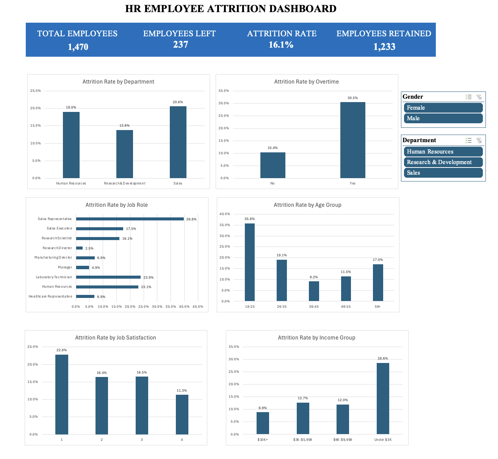

# HR Employee Attrition Analysis – Excel Dashboard

## Project Overview

This project analyzes employee attrition data using Microsoft Excel to identify workforce patterns across department, overtime, job role, age, job satisfaction, and income.

The project includes data preparation, calculated fields, PivotTable analysis, PivotCharts, KPI tracking, and an interactive Excel dashboard. Gender and Department slicers allow users to dynamically explore attrition patterns across the workforce.

## Dashboard

## Key KPIs

- Total Employees: 1,470
- Employees Left: 237
- Attrition Rate: 16.1%
- Employees Retained: 1,233

## Analysis Performed

The dashboard analyzes attrition across:

- Department
- Overtime
- Job Role
- Age Group
- Job Satisfaction
- Income Group

## Key Insights

- Sales had the highest department attrition rate at 20.6%, compared with 13.8% in Research & Development.
- Employees working overtime had a 30.5% attrition rate, compared with 10.4% for employees who did not work overtime.
- Sales Representatives had the highest job-role attrition rate at 39.8%.
- Employees aged 18–25 had the highest age-group attrition rate at 35.8%.
- Employees with Job Satisfaction Level 1 had a 22.8% attrition rate, while Level 4 had an 11.3% attrition rate.
- Employees earning under $3K per month had the highest income-group attrition rate at 28.6%.

## Tools & Skills

- Microsoft Excel
- Data Cleaning
- Excel Tables
- Calculated Columns
- Excel Formulas
- PivotTables
- PivotCharts
- Slicers
- Dynamic KPI Cards
- Data Visualization
- Dashboard Design

## Interactive Dashboard

The dashboard includes Gender and Department slicers. These filters dynamically update all six charts and the four KPI cards, allowing users to explore attrition patterns for different employee groups.

## Files

- `HR_Employee_Attrition_Analysis.xlsx` – Complete Excel workbook containing the data, analysis, PivotTables, and interactive dashboard
- `HR_Attrition_Dashboard.png` – Final dashboard preview

## Note

The findings represent patterns and associations within this dataset and should not be interpreted as evidence of causal relationships.
